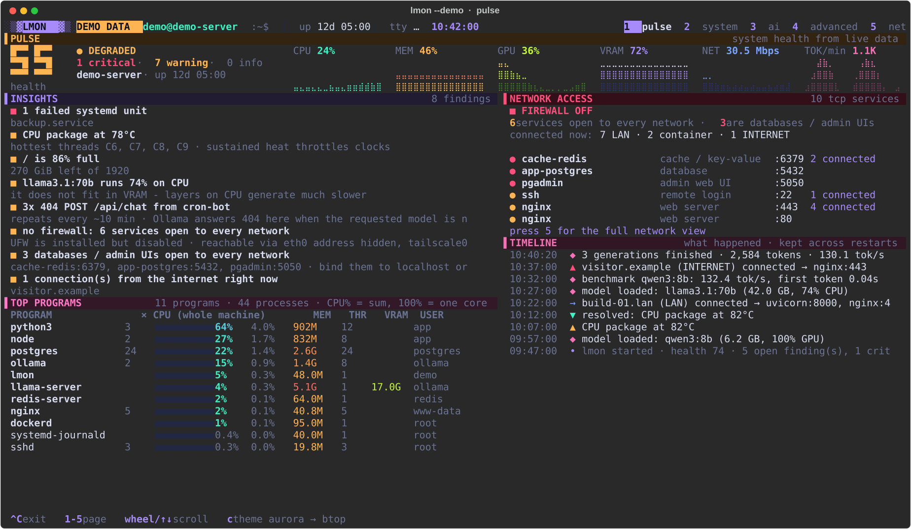
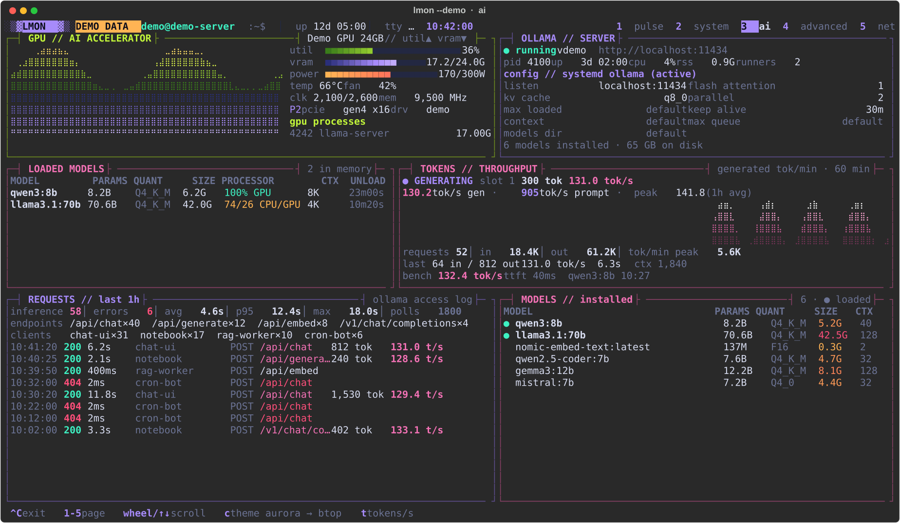
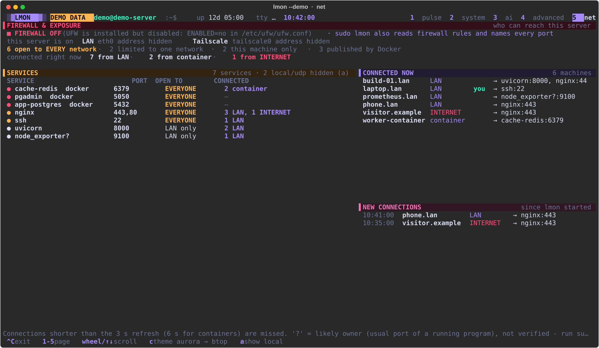
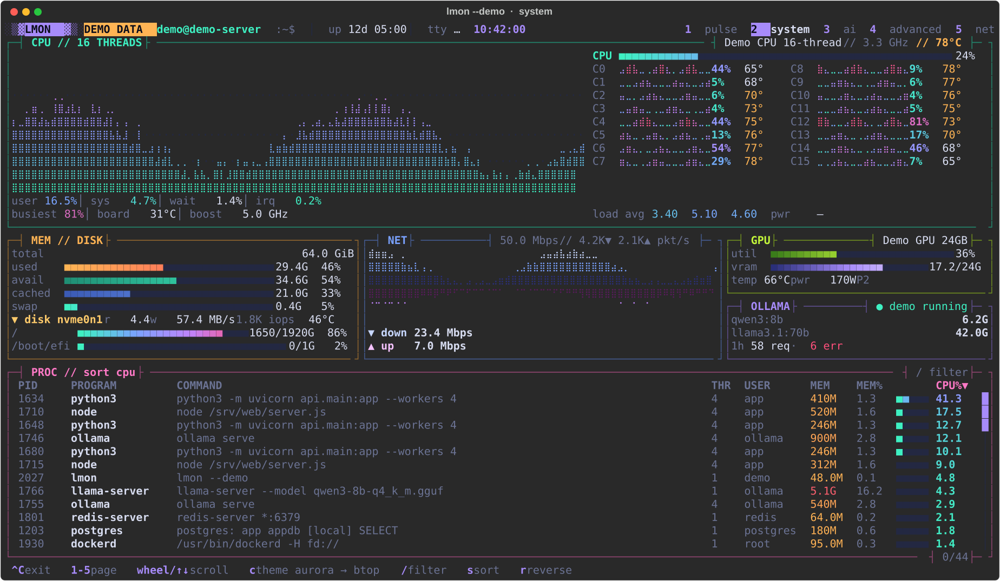
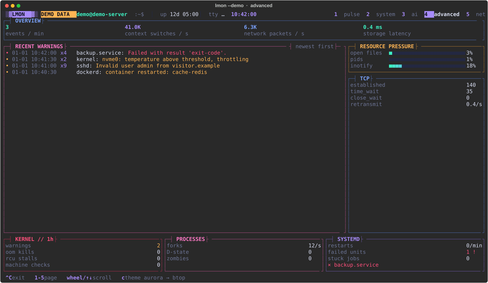

# lmon

**A Linux system monitor for the terminal that tells you what is wrong, not just what the numbers are.**



`lmon` works like `btop` - live graphs, per-thread CPU, a scrollable process list - and adds what a busy server
actually needs:

- **Pulse:** a health score with plain-language findings ("1 failed systemd unit", "llama3.1:70b runs 74% on
  CPU", "3x 404 POST /api/chat from cron-bot, repeats every ~10 min"), a timeline of what happened while you were
  away, and which programs are really using the machine.
- **AI workloads:** GPU detail, Ollama server configuration, loaded models and their CPU/GPU split, request
  latency and errors, and **live tokens per second for every request**, read from Ollama's own logs.
- **Network exposure:** is a firewall on, which services are open to every network (databases and admin UIs in
  red), and who is connected right now - including connections into Docker containers.

Everything shown is read from the machine itself. Nothing is estimated or simulated: when a source is not
available the field shows `—` and the panel says why.

> Status: early (0.x). Expect rough edges - [issues](../../issues) and pull requests are welcome.

## Screenshots

All screenshots come from `lmon --demo`, a made-up machine. Your own data never appears in them.

| AI workloads | Network exposure |
|---|---|
|  |  |

| System | Advanced |
|---|---|
|  |  |

## Setup guide

### 1. Check the requirements

- Linux with Python 3.9 or newer (`python3 --version`).
- A terminal with 24-bit colour (Windows Terminal, PuTTY 0.71+, iTerm2, GNOME Terminal, VS Code, ...).
- [pipx](https://pipx.pypa.io) is the easiest way to install: `sudo apt install pipx` (Debian/Ubuntu) or
  `python3 -m pip install --user pipx`.

### 2. Install

```bash
pipx install git+https://github.com/arunlearn13-cmd/Linux-Lmon.git
```

or from a clone (the script also offers to set up `sudo lmon`, see step 5):

```bash
git clone https://github.com/arunlearn13-cmd/Linux-Lmon.git
cd Linux-Lmon
./install.sh
```

### 3. Try it safely first

```bash
lmon --demo
```

This shows a made-up machine. It reads nothing from your computer, so it is the right way to look around, take
screenshots or show lmon to someone. Press `1`-`5` to switch pages and **Ctrl+C** to quit.

### 4. Run it on your machine

```bash
lmon
```

It starts on the pulse page and keeps running until you press Ctrl+C. Some panels stay empty until lmon is
allowed to read their source - that is step 5.

### 5. Optional: unlock more panels

Each step is optional. Skip any you do not need.

| To see | Do this | Notes |
|---|---|---|
| Journal warnings, kernel and systemd health, the Ollama request and token log | `sudo usermod -aG systemd-journal $USER` | log out and back in afterwards |
| Docker container names and connections into containers | `sudo usermod -aG docker $USER` | the docker group is equivalent to root access - only do this if you already trust that user with root |
| GPU panels | an NVIDIA GPU with its driver installed (`nvidia-smi` works) | AMD / Intel GPUs are on the [roadmap](ROADMAP.md) |
| AI workload page | [Ollama](https://ollama.com) running on this machine | another endpoint: set `OLLAMA_URL` |
| Firewall rule list, the process behind every port, CPU power | run `sudo lmon` | sudo only searches system folders, so link the command once: `sudo ln -sf ~/.local/bin/lmon /usr/local/bin/lmon` |

### 6. Optional: pick your look

```bash
lmon --theme btop        # aurora (default) | btop | neon | classic   - or press c while running
lmon --graph block       # if graphs show empty boxes (your font has no braille characters)
lmon --color 256         # for terminals without 24-bit colour (also: 16)
```

The theme you choose with `c` is remembered.

### Uninstall

```bash
pipx uninstall linux-monitor
sudo rm -f /usr/local/bin/lmon                    # only if you linked it in step 5
rm -rf ~/.config/lmon ~/.local/state/lmon         # saved theme and timeline
```

## Using lmon

| Key | Action |
|---|---|
| `1`-`5`, Tab, ← → | pages: pulse / system / ai / advanced / net (or click a tab) |
| mouse wheel, ↑ ↓, PgUp PgDn, Home End | scroll the list under the pointer |
| click | select a process |
| `/` | filter processes (Enter keeps it, Esc clears) |
| `s` / `r` | change process sort (cpu, mem, pid, name, threads, user) / reverse it |
| `t` | measure tokens/s on the loaded Ollama model (one short request) |
| `a` | net page: also show services that only listen on this machine, and UDP |
| `c` | next colour theme |
| Ctrl+C | exit (`q` does not exit, on purpose) |

The mouse wheel scrolls lmon, not your terminal's history. Hold **Shift** to select text with the mouse.

**Pages**

- **pulse** - health score, live vitals, insights, network access summary, top programs, timeline.
- **system** - CPU graph and per-thread history with temperatures, memory, disks, network, GPU, process list.
- **ai** - GPU, Ollama server and its configuration, loaded and installed models, tokens per second, requests.
- **advanced** - journal warnings, resource pressure, TCP, kernel, process and systemd health.
- **net** - firewall state, every listening service and who it is open to, who is connected, new connections.

Other options: `lmon --page ai` to start on a page, `lmon --once --width 160 --height 45` to print one frame,
`lmon --version`, `lmon --help`.

## Sharing screenshots safely

On your own machine lmon shows real details: hostname, user name, addresses of connected machines, process
names and command lines, open ports. Before you post a screenshot in an issue, a chat or a blog:

- use `lmon --demo` when you only want to show what lmon looks like, or
- cover or crop hostnames, user names, addresses and process details.

## What lmon does on your machine

- **Reads only.** `/proc`, `/sys`, `journalctl`, `systemctl show`, `nvidia-smi`, `docker ps` / `docker inspect`
  and Ollama's local API. It never changes the system.
- **No data leaves the machine.** No telemetry, no update checks. The only network connection is to Ollama
  (`OLLAMA_URL`, by default on this machine).
- **Ollama load:** the `t` benchmark sends one short request to a model that is already loaded and never loads a
  model. Nothing else generates tokens.
- **Files it writes:** `~/.config/lmon/theme` and `~/.local/state/lmon/timeline.jsonl` - also under `sudo`,
  where they stay owned by you.

## Web dashboard (optional)

`lmon --web` serves a browser dashboard and a JSON API (`/api/metrics`).

| Variable | Default | Purpose |
|---|---|---|
| `MONITOR_HOST` / `MONITOR_PORT` | `localhost` / `8202` | where the web dashboard listens |
| `MONITOR_TOKEN` | not set | require `Authorization: Bearer <token>` on `/api/metrics` (open the UI with `/?token=<token>`) |
| `OLLAMA_URL` | `http://localhost:11434` | Ollama endpoint (terminal and web) |

By default it is reachable only from the same machine. To open it to other machines, set `MONITOR_HOST` to the
address to listen on **and** set `MONITOR_TOKEN`, and allow the port only from trusted hosts in your firewall
(or put it behind a TLS reverse proxy). `deploy/linux-monitor.service` is a hardened systemd unit for running it
as a service.

## Data sources and limits

- Token figures come from Ollama's runner log (`slot print_timing` lines). With `OLLAMA_NUM_PARALLEL` above 1,
  which request a token count belongs to is approximate when requests overlap; totals are exact.
- Connections refresh every 3 seconds (6 for containers); shorter connections are missed. Names of sockets owned
  by other users need `sudo lmon`; until then a likely owner is shown as `name?`.
- CPU power and the firewall rule list are root-only on most systems.
- Per-core temperatures appear only when sensors map one-to-one to logical CPUs.

## Contributing

Bug reports, ideas and pull requests are welcome - see [CONTRIBUTING.md](CONTRIBUTING.md) for the development
setup and the rules that keep lmon trustworthy (real data only, read-only, nothing leaves the machine). Where the
project is heading: [ROADMAP.md](ROADMAP.md). What changed in each release: [CHANGELOG.md](CHANGELOG.md).
Security problems: please report them privately as described in [SECURITY.md](SECURITY.md).

## License

[MIT](LICENSE) © 2026 Arun K
